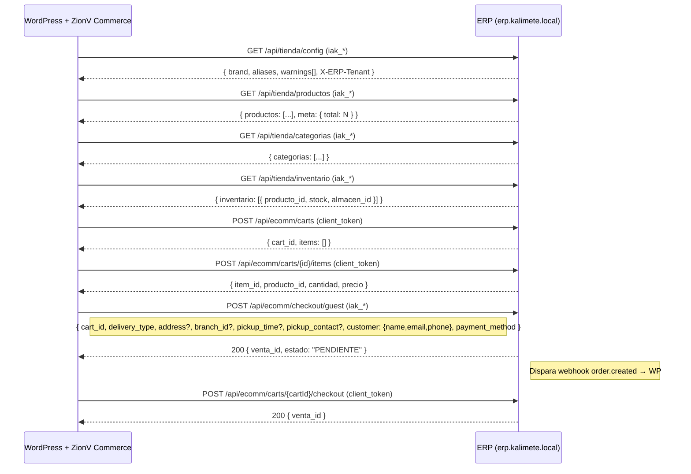

> **Frescura** — el diagnostico SIEMPRE empieza con estado real (docker ps, curl :health, systemctl, journalctl, ss...). Lo pegado en este doc (estados, contadores, versiones, salidas viejas) NUNCA es verdad: este doc es la RECETA (flags, topologia querida, no-touch, historia); el edificio es lo live. Si discrepan -> actua sobre lo LIVE, cura este doc + su harness (+ CHANGELOG) y reporta la deriva. Docs upstream (GitHub/vendor) solo cuando lo live no explica el fallo — no se cachean como verdad permanente.

# ERP Dev — Preprod ERP (kalimete)

## Visión

Gestión del preprod dockerizado de erpipo en kalimete. Stack standalone local, desvinculado de prod desde 2026-09-19.

**Modelo de ownership (owner, 2026-10-05; workflow definitivo 2026-10-18)**: el upstream es de **Juan Carlos** (`soycarlosjerez-hub/sistema-facturacion`, GitHub). **Tenemos acceso al repo**: `dev/ecomm-erp` es **nuestra rama de trabajo** — ahí hacemos los updates y todo lo que el plugin **Armada Suite** necesita para funcionar correctamente (push a ESA rama = flujo normal, autorización permanente del owner 2026-10-18). **Juan Carlos mergea `dev/ecomm-erp` → `main` y pasa a producción — NUNCA nosotros** (ERP prod intocable desde kalimete). `main`/`develop` read-only.

## Nueva Arquitectura: ZionV CRM Core + ZionV Commerce (2026-10-28)

### Separación de responsabilidades

| Componente | Tipo | Usa ERP | business_mode | Pack default |
|---|---|---|---|---|
| **ZionV CRM Core** | Plugin independiente | **NO** | `zion_crm` / `none` | `neutral` |
| **ZionV Commerce** | Plugin dependiente (requiere CRM Core) | **SÍ** | `ecommerce` | `commerce` |

### Tenants atendidos por ERP Dev

| Tenant | Negocio | business_mode | ERP activo |
|---|---|---|---|
| **10** | MaganTech | `ecommerce` | ✅ Sí |
| **3** | Micaserogou | `ecommerce` | ✅ Sí |

> **Regla**: ZionV CRM Core (business_mode = `zion_crm`/`none`) **nunca** consume endpoints ERP. Solo ZionV Commerce (`business_mode = ecommerce`) integra con ERP.

## Endpoints ERP para ZionV Commerce (v2026-10-28)

### Catálogo público (store-key: `Authorization: Bearer iak_*`)

| Endpoint | Método | Descripción | Auth |
|---|---|---|---|
| `/api/tienda/productos` | GET | Listado paginado de productos | `iak_*` (store-key) |
| `/api/tienda/categorias` | GET | Categorías activas del tenant | `iak_*` (store-key) |
| `/api/tienda/inventario` | GET | Stock por producto/almacén | `iak_*` (store-key) |
| `/api/tienda/kardex/{id}` | GET | Movimientos de stock de un producto | `iak_*` (store-key) |
| `/api/tienda/config` | GET | Configuración de la tienda (brand, aliases, warnings) | `iak_*` o `?api_key=` |
| `/api/tienda/inventario/ajuste` | POST | Ajuste de inventario (admin) | `iak_*` (store-key) |

### Ecomm Storefront (client-token: `Authorization: Bearer <client_token>`)

| Endpoint | Método | Descripción | Auth |
|---|---|---|---|
| `/api/ecomm/register` | POST | Registro de cliente (resuelve tenant por iak) | `iak_*` |
| `/api/ecomm/login` | POST | Login cliente → devuelve `client_token` | `iak_*` |
| `/api/ecomm/logout` | POST | Cierre de sesión | `client_token` |
| `/api/ecomm/me` | GET | Perfil del cliente autenticado | `client_token` |
| `/api/ecomm/carts` | POST | Crear carrito | `client_token` |
| `/api/ecomm/carts/{id}` | GET | Ver carrito | `client_token` |
| `/api/ecomm/carts/{id}/items` | POST/GET/DELETE | Gestión items del carrito | `client_token` |
| `/api/ecomm/carts/{cartId}/checkout` | POST | Checkout autenticado | `client_token` |
| `/api/ecomm/checkout/guest` | POST | Checkout invitado (sin login) | `iak_*` |
| `/api/ecomm/orders` | GET | Listado pedidos del cliente (`?customer_id=`) | `client_token` |
| `/api/ecomm/orders/{id}` | GET | Detalle pedido individual (scoping auth.cliente) | `client_token` |
| `/api/ecomm/orders/{id}/cancel` | PATCH | Cancelar pedido (G1, Fase 3) | `client_token` |
| `/api/ecomm/promociones/validar` | POST | Validar código promo (requiere `codigo`+`cart_id`+`subtotal`) | `client_token` |

### Webhooks Management (admin: `Authorization: Bearer iak_*`)

| Endpoint | Método | Descripción |
|---|---|---|
| `/api/webhook-endpoints` | GET/POST | Listar/crear endpoints de webhook |
| `/api/webhook-endpoints/{id}` | GET/PATCH/DELETE | CRUD individual |
| `/api/webhook-endpoints/{id}/test` | POST | Test de entrega |
| `webhooks:retry-failed` | Artisan CLI | Reintentar entregas fallidas (G4, Fase 3) |

### Health & Diagnostics

| Endpoint | Método | Descripción |
|---|---|---|
| `/up` | GET | Health check JSON `{status, database, redis, timestamp}` (200/503) |

---

## Guía de Integración: ZionV Commerce → ERP

### 1. Autenticación

#### InstanceApiKey (store-key) — para catálogo público y operaciones admin
```bash
# Header
Authorization: Bearer iak_<hash>

# Uso: /api/tienda/*, /api/ecomm/tienda/config, /api/webhook-endpoints/*
# El tenant se deriva AUTOMÁTICAMENTE de la iak (tabla instance_api_keys)
# NUNCA enviar tenant_id en body/query — anti-IDOR
```

#### ClientApiToken (client-token) — para operaciones personales del cliente
```bash
# Flujo:
# 1. POST /api/ecomm/login con iak_* → devuelve { token: "cat_...", expires_in: 3600 }
# 2. Usar token en header para endpoints personales
Authorization: Bearer cat_<token>

# Uso: /api/ecomm/me, /api/ecomm/carts/*, /api/ecomm/orders/*, /api/ecomm/checkout/*
```

> **Regla crítica**: El tenant **nunca** va en el body. Se deriva de la iak (store-key) o del client_token (per-cliente). Enviar `tenant_id` en body = 422/403.

### 2. Flujo típico ZionV Commerce



### 3. Payloads Canónicos (NO inventar campos)

```jsonc
// CARRITO — POST /api/ecomm/carts → 201
// tenant NUNCA en body; deriva de la iak/client_token
{ "type": "REC", "order_type": "pickup", "items": [ {"producto_id": 323, "cantidad": 1} ] }

// CHECKOUT GUEST — POST /api/ecomm/checkout/guest → 200 (NO 201)
// delivery:
{ "cart_id": 70, "delivery_type": "delivery", "address": "…", "city": "…",
  "notes": "…", "payment_method": "efectivo",
  "customer": {"name": "…", "email": "…", "phone": "…"} }
// pickup (requiere sucursal ACTIVA del tenant):
{ "cart_id": 70, "delivery_type": "pickup", "branch_id": 6,
  "pickup_time": "Y-m-d H:i", "pickup_contact": "…",
  "customer": {"name": "…", "email": "…", "phone": "…"} }

// RESERVA — POST /api/reservations → 201
{ "mesa_id": 20, "fecha_hora": "Y-m-d H:i:s", "personas": 2,
  "cliente_nombre": "…", "cliente_telefono": "…", "cliente_email": "…",
  "estado": "pendiente", "notas": "" }
```

### 4. Webhooks ERP → WP (ZionV Commerce)

#### Configuración en ERP (una vez por tenant)
```sql
-- Tabla: webhook_endpoints
INSERT INTO webhook_endpoints (instance_id, url, events, secret, active) VALUES
(10, 'https://maganTech.com/wp-json/zionv-commerce/v1/webhook/erp',
 '["order.created","stock.updated","price.updated"]',
 '<secret_compartido>', 1);
```

#### Eventos disparados

| Evento | Cuándo | Payload clave |
|---|---|---|
| `order.created` | Checkout guest/auth exitoso | `venta_id`, `cliente_id`, `items[]`, `total`, `delivery_type` |
| `stock.updated` | Venta confirmada + ajuste inventario | `producto_id`, `stock_nuevo`, `almacen_id`, `tipo_movimiento` |
| `price.updated` | Admin actualiza precio en ERP | `producto_id`, `precio_nuevo`, `precio_anterior`, `moneda` |

#### Formato de entrega (HMAC-SHA256)
```http
POST /wp-json/zionv-commerce/v1/webhook/erp
X-Webhook-Event: order.created
X-Webhook-Delivery: <uuid>
X-Webhook-Timestamp: <unix_ts>
X-Webhook-Signature: sha256=<hmac(secret, payload)>
Content-Type: application/json

{ "event": "order.created", "data": { ... }, "tenant_id": 10 }
```

#### Validación en WP (ZionV Commerce)
```php
// En el handler del webhook
$signature = $_SERVER['HTTP_X_WEBHOOK_SIGNATURE'] ?? '';
$payload = file_get_contents('php://input');
$expected = 'sha256=' . hash_hmac('sha256', $payload, $secret);
if (!hash_equals($expected, $signature)) {
    wp_die('Invalid signature', 401);
}
// Procesar evento...
```

#### Retries automáticos (ERP side)
- Backoff: 30s → 60s → 120s → 300s (máx 4 reintentos)
- Job: `WebhookDeliveryJob` en cola `webhooks`
- Comando manual: `php artisan webhooks:retry-failed`

### 5. Delta-Sync (no hay `?since=` nativo)

> **Limitación**: ERP **no expone** parámetro `?since=` ni `?updated_at=` en endpoints de catálogo.

#### Estrategia client-side (ZionV Commerce)

```php
// 1. Obtener catálogo completo (paginado)
$productos = [];
$page = 1;
do {
    $resp = $http->get('/api/tienda/productos', ['page' => $page, 'per_page' => 100]);
    $productos = array_merge($productos, $resp['productos']);
    $page++;
} while (!empty($resp['productos']));

// 2. Filtrar localmente por updated_at
$ultimoSync = get_option('zionv_last_erp_sync', 0);
$nuevos = array_filter($productos, fn($p) => strtotime($p['updated_at']) > $ultimoSync);

// 3. Actualizar solo los cambiados
foreach ($nuevos as $p) {
    update_product_from_erp($p);
}
update_option('zionv_last_erp_sync', time());
```

#### Frecuencia recomendada
- **Catálogo completo**: cada 15-30 min (cron WP)
- **Stock (inventario)**: cada 5 min (más crítico)
- **Webhooks**: tiempo real (order.created, stock.updated, price.updated)

#### Cache TTL en WP
```php
// Transient para catálogo (evita hammer al ERP)
$cacheKey = "zionv_erp_catalog_{$tenant_id}";
$catalog = get_transient($cacheKey);
if (!$catalog) {
    $catalog = fetch_full_catalog_from_erp();
    set_transient($cacheKey, $catalog, 900); // 15 min
}
```

---

## Acceso

- **URL**: `https://erp.kalimete.local` (nginx TLS local, `-k` o CA mkcert)
- **phpMyAdmin**: `https://erp.kalimete.local/phpmyadmin` (:8102)
- **mailpit**: `http://localhost:8025` (captura email dev — **dev-only intencional**, owner 2026-10-13; producción usa mail real según main de Juan Carlos)
- **Stack Docker**: `~/dev/erpipo-preprod/` (docker-compose.yml)
- **Código**: `~/dev/erpipo-preprod/code/sistema-facturacion/`
- **Keys de integración**: `~/dev/erpipo-preprod/keys/` (dir 700, files 600 — p.ej. `ecomm-test-customer.txt`; NUNCA imprimir valores)
- **Backups de .bkup viejos**: `~/dev/erpipo-preprod/backups-bkup-20261003/` (movidos fuera del repo 2026-10-05)

## Git — política de rama única (commit dd66417)

- **Rama activa**: `dev/ecomm-erp` (el stack preprod SIRVE esta rama; `main`/`develop` son **read-only**)
- **Remotos**: SOLO `origin` = `ssh://git@github.com/soycarlosjerez-hub/sistema-facturacion.git` (upstream de Juan Carlos). **NO existe remote `preprod` en este clon**.
- **Workflow (definitivo, owner 2026-10-18)**: desarrollar/probar local → commits limpios en `dev/ecomm-erp` → **push a origin (autorización permanente del owner para esta rama)** → **Juan Carlos mergea a `main` y despliega a producción** (él integra vía PR: #13 el 2026-10-06 integrando nuestra base 2d0d97b, **#14 el 2026-10-07 integrando nuestra Fase 2/3 a main**). El camino a prod del ERP es SOLO el merge de Juan — nosotros jamás deployamos.
- **Estado push (2026-10-19 — ✅ JUAN MERGEÓ TODO vía PR #15 `997a218`)**: los 8 commits nuestros están en `origin/main` Y en `origin/develop` (verificado con `merge-base --is-ancestor`): G6 fix `ff64301`, G1 cancel `e495454`+`8ae9bb2`, G2 webhooks CRUD `f961503`, G3 `invoice.issued` `5ace5aa`, G4 retry-failed `601959e`, merge `2306b64`, **identidad ecomm `34de630`** (brand.name garantizado + aliases + warnings IDENTITY_EMPTY + X-ERP-Tenant + X-API-Key — backward compatible, consumido por WP Armada Suite 5.3.3+). Nuestra rama `dev/ecomm-erp` fast-forwardeada a `997a218` (= main = develop) y pushed. Su integración en prod: migraciones (2) + `--queue=default,webhooks` en su worker — su lado.

## Stack (docker-compose.yml, verificado 2026-10-05)

| Servicio | Container | Puerto | Imagen |
|---|---|---|---|
| app | erpipo-preprod-app | 9000/tcp interno (SIN puerto host) | erpipo-preprod (build) |
| nginx | erpipo-preprod-nginx | :8100 | nginx:1.25-alpine |
| db | erpipo-preprod-db | :3310 | mysql:8.0 (healthy) |
| redis | erpipo-preprod-redis | :6390 | redis:7-alpine (healthy) |
| queue | erpipo-preprod-queue | — | erpipo-preprod |
| scheduler | erpipo-preprod-scheduler | — | erpipo-preprod |
| phpmyadmin | erpipo-preprod-phpmyadmin | :8102 | phpmyadmin:latest |
| mailpit | erpipo-preprod-mailpit | :8025 | axllent/mailpit (healthy) |

## Configuración

- **User app**: 1000:1000 (mismo UID que warcold en kalimete)
- **DB**: `facturacion_db` — creds en `~/dev/erpipo-preprod/preprod.env` (NO en docs)
- **.env**: preprod.env (APP_URL=https://erp.kalimete.local, APP_ENV=preprod, APP_DEBUG=false, verificado con `artisan about`)
- **Tenants**: tabla **`business_instances`** (NO `tenants`) — tenant 10 MaganTech `activo=1` (verificado 2026-10-13)
- **Key `ecomm-test-customer.txt` STALE (2026-10-13)**: `/api/ecomm/me` → 401 "Token inválido" (token de cliente expirado/revocado) — regenerar cuando se necesite otro e2e
- **SSL**: mkcert (erp.kalimete.local.pem + -key.pem)
- **App**: Laravel 12.16, PHP 8.3.33, cache/queue/session redis, db mysql, routes/events/views CACHED

## Migraciones y datos (verificado 2026-10-06)

- DB: `facturacion_db` con **655 migraciones (batch 150)**, 330 tablas; users 31, clientes 180+, productos 799, ventas 253+
- Dump original: `~/dev/erpipo-preprod/db.sql` (553MB) — **NUNCA modificar ni borrar**
- Scheduler: `recurring-invoices`, `ecf:consultar-pendientes`, `cajas:limpiar-sesiones`, `communication:process-outbox` (DONE cada minuto)
- **Queue worker**: `php artisan queue:work --queue=default,webhooks --tries=3 --timeout=90 --sleep=3` (compose local curado 2026-10-06 con .bkup; sin `--queue=` los webhooks NO se procesan)

## Contrato ecomm API (verificado end-to-end 2026-10-05/06 — Fase 2 aplicada)

- **Auth**: `Authorization: Bearer iak_*` (InstanceApiKey, sha256 en `instance_api_keys`). `/api/ecomm/tienda/config` también acepta `?api_key=`. Token de cliente (login ecomm) es compatible con `auth.cliente` vía el MISMO header Bearer.
- **Rutas clave**: `GET /api/tienda/{productos,categorias,inventario,kardex/{id},config}` + `POST /api/tienda/inventario/ajuste`; ecomm storefront: `POST /api/ecomm/{register,login,logout,...}`, `GET /api/ecomm/me`, `carts` CRUD + `carts/{id}/items` + `carts/{cartId}/checkout` + `checkout/guest`, `orders` (listado `?customer_id=`) + **`GET /api/ecomm/orders/{id}` (NUEVO Fase 2 — detalle individual con scoping auth.cliente, ajena=404)**, `promociones/validar` (requiere `codigo`+`cart_id`+`subtotal`), lealtad.
- **Register (Fase 2)**: resuelve tenant por precedencia `tenant_id` explícito > `api_key` (body/X-API-Key/Bearer) > **422 `tenant_required`** (fin del default silencioso a tenant 3). Lookup canónico: `InstanceApiKey::activeByHash()` (sin TenantScope).
- **Checkout (Fase 2)**: **ya NO requiere caja POS abierta** — sin `sesion_cajas` abierta la venta se crea con `sesion_caja_id`/`user_id` NULL (migración `2026_10_05_230000`); el POS intacto (siempre pasa sesión).
- **Throttles**: register/login 10/min; `/api/ecomm/tienda/config` 30/min; grupo tienda/ecomm-privado 60/min.
- **Health (Fase 2)**: `GET /up` → JSON `{status, database, redis, timestamp}` (200 ok / 503 degraded; pings sin crash). Reemplaza el blade HTML nativo.
- **Webhooks (Fase 2, NUEVO)**: tablas `webhook_endpoints`/`webhook_deliveries`; `WebhookService::dispatch(event, tenantId, payload)`; job con HMAC-SHA256 (`X-Webhook-Signature`), headers `X-Webhook-Event/-Delivery/-Timestamp`, retries backoff [30,60,120,300], afterCommit. Eventos cableados: `order.created` (ecomm submit+guest), `stock.updated` (venta+ajuste), `price.updated` (admin update). Alta de endpoints vía tinker/DB (soporta wildcard `*`). Verificado e2e: entregas sent/200 con firma validada.
- **Hallazgos para el consumidor (WP/Alfredo)**: imágenes = URLs absolutas a erp.kalimete.local (proxy/rehost desde WP); total del catálogo en `meta.total` (keys: `productos`+`meta`); `telefono` unique scoped por tenant en código (sin index DB — duplicados cross-tenant impiden index compuesto hasta dedupe).
- **E2E verificado**: register→verify-email(sha1)→login→me OK; cart→checkout SIN caja → ventas 283/288/289 (sesion_caja_id NULL, stock decrementado); promos 400 `invalid_code`; imágenes webp 200; webhooks entregas sent/200 firma OK.

## Reglas de operación

1. **NUNCA** modificar el dump original (`~/dev/erpipo-preprod/db.sql`)
2. **NUNCA** `migrate:refresh` ni `migrate:fresh` — destruyen todos los datos (ver AGENTS.md del proyecto)
3. **NUNCA** commitear `.env*`, `*.sql`, `releases/`, `storage/*` (el .gitignore ya los cubre; verificar con `git status`)
4. Push a `origin` SOLO en `dev/ecomm-erp` (autorización permanente del owner 2026-10-18 — es nuestra rama de trabajo); `main`/`develop` read-only; **merge a main + deploy a prod = SOLO Juan Carlos**
5. **BACKUP** de configs antes de modificar (`.bkup-YYYYMMDD` — y moverlos fuera del repo tree al terminar)
6. **Siempre** verificar que el preprod funciona después de cambios (`curl -sk https://erp.kalimete.local/login`)
7. **Actualizar** docker-compose.yml si se agregan servicios o puertos
8. **Documentar** cambios en CHANGELOG.md tras cada modificación

## Comandos útiles

```sh
# Ver estado
cd ~/dev/erpipo-preprod && docker compose ps

# Logs
docker logs --tail 50 erpipo-preprod-app
docker logs --tail 50 erpipo-preprod-nginx

# Acceder al container
docker exec -it erpipo-preprod-app bash

# Reiniciar / recrear
docker compose restart
docker compose up -d --build   # solo si cambió Dockerfile

# Limpiar cache de Laravel
docker exec erpipo-preprod-app php artisan cache:clear && \
docker exec erpipo-preprod-app php artisan config:clear && \
docker exec erpipo-preprod-app php artisan view:clear && \
docker exec erpipo-preprod-app php artisan route:clear

# MySQL (creds en preprod.env — nunca inline en docs/historial)
docker exec erpipo-preprod-db sh -c 'mysql -u root -p"$MYSQL_ROOT_PASSWORD" facturacion_db -e "SHOW TABLES;"'

# Backup manual
docker exec erpipo-preprod-db sh -c 'mysqldump -u root -p"$MYSQL_ROOT_PASSWORD" facturacion_db' > backup.sql

# Ver migraciones pendientes
docker exec erpipo-preprod-app php artisan migrate:status
```

## Permisos

- **storage/logs/** y **storage/framework/**: 775, owned by warcold:warcold (UID 1000)
- Si se crean archivos con root: root, cambiar ownership: `chown -R 1000:1000 storage/`

## Producción (desvinculada 2026-09-19)

- Sin acceso al servidor externo: alias SSH retirado, sin registro en MAPA ni en este agente.
- El preprod es standalone: su DB (`facturacion_db`) vive solo en el volumen de kalimete.
- No tocar ni referenciar infraestructura de terceros. Los cambios viajan por Git: **nosotros actualizamos `dev/ecomm-erp` (push directo)**; **Juan Carlos mergea a `main` y despliega a producción — nosotros NUNCA deployamos ERP prod** (owner 2026-10-18).

## Fase 2 — IMPLEMENTADA y pushed (2026-10-06)

Los 7 candidatos Fase 2 fueron implementados, verificados e2e y **pushed a origin** (`dev/ecomm-erp` HEAD `2c8fca9`, 10 commits + merge con el PR #13 de Juan). Resumen en `docs/RECOMENDACIONES-FASE2-ECOMM.md` del propio repo (viaja con la rama) + entrada en el CHANGELOG del repo (`790cc8a`).

| Commit | Mejora |
|---|---|
| `4415e27` | `GET /api/ecomm/orders/{id}` con scoping auth.cliente |
| `ba62435` | register deriva tenant de la API key (fin default tenant 3) |
| `4e1a216` | LogErrorToDatabase tolera caída de MySQL (fin loop log-del-log) |
| `c470bf2` | `/up` JSON real (200 ok / 503 degraded) |
| `a2b183e` | checkout sin caja POS (sesion_caja_id/user_id nullable, migración) |
| `dbb1998`+`27be061`+`2893551` | webhooks MVP (HMAC-SHA256, retries, afterCommit; order.created/stock.updated/price.updated) |
| `9a18a04`+`790cc8a` | docs: RECOMENDACIONES-FASE2 + changelog del repo |

## Fase 3 — G1-G4+G6 IMPLEMENTADOS y pushed; webhooks ACTIVOS (estado 2026-10-13)

- **Doc**: `docs/RECOMENDACIONES-FASE3-AGENTE.md` (`95d17d8`, pushed): matriz 26 capacidades, modelo auth mixto (store-key lo no personal / token per-cliente lo personal), gaps G1-G5 priorizados.
- **G6 CORREGIDO POR NOSOTROS** (`ff64301`, 2026-10-08, pushed): `ajusteInventario` ya NO da 500 — `notas ?? null`, insert sin `linea_negocio`, tipo enum, `almacen_id` default. **Live en preprod** (bind mount HEAD). El doc viejo decía "lo corrige Juan" — deriva corregida: la corrección es nuestra.
- **G1-G4 implementados** (2026-10-08, pushed): G1 `PATCH /api/ecomm/orders/{id}/cancel` + 11 tests (`e495454`+`8ae9bb2`); G2 CRUD webhook endpoints por API (`f961503`); G3 evento `invoice.issued` (`5ace5aa`); G4 `webhooks:retry-failed` (`601959e`). **Solo G5 queda pendiente** (teléfono/stock-sucursal/detalle).
- **Webhooks activos**: endpoint WP dado de alta (`webhook_endpoints` id=2, instance 10, events order.created/stock.updated/price.updated). E2E verificado: checkout → deliveries `sent/200` → WP invalida caché. Red docker compartida `erpipo-dev-network` con el stack WP (container-to-container, sin exponer puertos).
- **Juan integró nuestra Fase 2/3 a main vía PR #14** (2026-10-07) + refactor `34bd716` (VentaController/SaleCancelService/SaleStockService/helpers.php) + módulo renta vehículos `bd1a879` (~20 controllers/models, ortogonal a ecomm) — todo ya mergeado en nuestro HEAD sin conflictos.

## Review de Juan — ✅ COMPLETADA (PR #15, 2026-10-19)

**✅ RESUELTO (2026-10-19)**: Juan integró TODO vía **PR #15** (`997a218` = merge de `dev/ecomm-erp` a `main`; `develop` también avanzó). Verificado commit por commit (`merge-base --is-ancestor` × 8). Nuestra rama quedó fast-forwardeada a `997a218` y pushed (= main = develop). Lo que le tocaba a su lado (migraciones ×2, worker `--queue=default,webhooks`) es cosa suya — ERP prod verificado vivo y sano post-deploy (ping-erp desde WP prod: 200 ok, 438ms, catálogo fluye).

**Pendiente siguiente (no implementado)**: solo **G5** (teléfono/stock-sucursal/detalle, S/M).

## Docs oficiales (2026-10-08 — directiva del owner: programar segun estandares de los creadores)
> Regla: ANTES de programar/configurar contra el ERP, consultar estas fuentes. El upstream es de Juan Carlos (recomendaciones via branch `dev/ecomm-erp`) — NUNCA tocar prod (desvinculada 2026-09-19). NUNCA inventar endpoints del contrato ecomm API.
- **Upstream erpipo**: repo de Juan Carlos, rama `dev/ecomm-erp` + `docker-compose.yml` local + fases del .md (canonico del contrato).
- **Componentes verificados**: nginx https://nginx.org/en/docs/ · MySQL 8.0 https://dev.mysql.com/doc/ · Redis https://redis.io/docs/

## PRIMERA LECTURA (cierre maratón 2026-10-25)

1. **Estado consolidado del ERP**: `~/dev/erpipo-preprod/AGENTS-ESTADO.md` — boundary (ERP=solo data; identidad visual NUNCA del ERP), contrato congelado con payloads canónicos, 6 gaps abiertos (todos Juan Carlos), residuos TEST. Leer ANTES de cualquier análisis.
2. Reglas locales: `~/dev/erpipo-preprod/REGLAS.md`.
3. La matriz de intercambio de la flota: `docs/ESTADO-ECOSISTEMA.md` del plugin canónico Armada Suite.

## Upstream (2026-10-13)

- **Fuente**: `soycarlosjerez-hub/sistema-facturacion` (upstream de Juan Carlos) + stack erpipo-* (kalimete :8100).
- **Vivo 2026-10-19**: **PR #15 mergeado por Juan** (`997a218`) — los 8 commits nuestros en main+develop; `dev/ecomm-erp` fast-forwardeada a `997a218` = main = develop (ls-remote); `/up` ok tras el sync; ERP prod validado desde WP prod (ping-erp 200 ok, 438ms, products:1, key b221457f válida). **Pendiente del lado WP**: sync de identidad para que la marca "Tienda" → nombre (prod WP corre 5.4.0 = sync manual; el hint brand_name sigue "" — sin sync post-deploy).
- **Vivo 2026-10-18**: 8/8 containers Up 10h (db/redis/mailpit healthy); `/up` ok (database+redis true); `dev/ecomm-erp` @`34de630` = HEAD = origin (ls-remote verificado); `origin/main` @`bd1a879` — 8 commits nuestros esperando el merge de Juan; tree local limpio. **Workflow GitHub definitivo (owner 2026-10-18)**: acceso pleno al repo, updates directos en `dev/ecomm-erp` para todo lo que Armada Suite necesita, Juan mergea a main → prod (nunca nosotros).
- **Vivo 2026-10-16**: 8/8 containers Up 4d (db/redis/mailpit healthy); rama `dev/ecomm-erp` @`34de630` pushed = HEAD; **al día con origin/main** (fetch verificado, 0 commits faltantes); webhooks activos hacia WP (endpoint id=2); red compartida con WP; tenant 10 MaganTech activo; config ecomm verificado 200 (tenant 3: brand.name + aliases + warnings[] + X-ERP-Tenant, commit `34de630`).
- **Latencia (2026-10-13)**: `/up` directo :8100 = ~130ms estable; vía HTTPS nginx = 490-1140ms — el ping-erp de WP (~250-300ms) es overhead TLS/nginx **esperado del entorno dev local**, no un bug. **Decisión owner 2026-10-13**: mailpit es **dev-only intencional** (catcher SMTP local para no operar un servidor de correos; en producción el mail es real según main de Juan Carlos) — NO investigar más, NO tocar (ni producción ni preprod). El preprod se alimenta de main de Juan Carlos adaptado a la red local — pruebas lo más cerca posible de producción, sin vínculo con prod.
- **Check**: `docker ps -f name=erpipo` + `curl -sk https://erp.kalimete.local/login` + `curl -s http://127.0.0.1:8100/up`
- **Regla**: LIVE manda (doc vs live vs upstream); push a `dev/ecomm-erp` = flujo normal (autorización permanente del owner 2026-10-18); `main`/`develop` read-only; merge→main + deploy prod = SOLO Juan Carlos.


```json upstream_drk
{
  "enabled": true,
  "id": "erp-dev",
  "label": "git HEAD soycarlosjerez-hub/sistema-facturacion (rama dev/ecomm-erp)",
  "source": "releases/latest (upstream Juan Carlos)",
  "href": "github.com/soycarlosjerez-hub/sistema-facturacion",
  "href_docs": "",
  "pin_note": "dev/ecomm-erp = nuestra rama de trabajo (push autorizado owner 2026-10-18); merge a main + prod = SOLO Juan Carlos",
  "groom_clean": true
}
```

> **Harness**: `~/armada-sync/harness/erp-dev.harness.json` (scope + live_check + upstream + docs + changelog de este agente).
